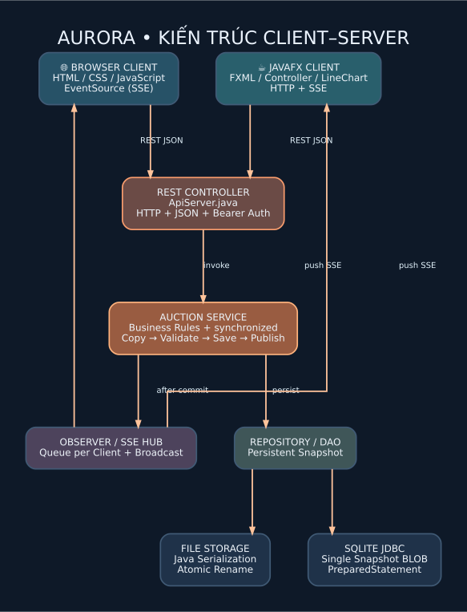

# AURORA — Online Auction System (UET.CS2043 / LTNC 2026)

**Website + JavaFX MVC client + Java 21 server + persistent DAO + SSE realtime**

AURORA is an educational online-auction system following the 2026 assignment documents. Both clients call the same Java server; all pricing decisions and persistent data are server-side. The browser UI is an additional client, **not a replacement for the required JavaFX/FXML client**.



## 1. Requirements

- **OOP:** abstract `Entity`, abstract `User` with `Bidder` / `Seller` / `Admin`; abstract `Item` with `Electronics` / `Art` / `Vehicle`; `Auction`, `BidTransaction`, `AutoBid`.
- **Design patterns:** Singleton (`AuctionService.singleton`), Factory Method (`ItemFactory.create`), Observer (`AuctionService.observe` / `Events.broadcast`), DAO Repository (`FileRepository`, `SqliteRepository`).
- **Core:** register/login; role-based access; seller product CRUD; manual bids and validation; leader, history, timed state changes; paid/canceled status; error responses.
- **Concurrency:** all critical mutations serialized by synchronized service; transaction strategy copy → validate → durable save → publish; same-price concurrent bids yield one acceptance only.
- **Realtime:** server broadcasts committed events over SSE; web `EventSource`, JavaFX streaming HTTP listener; no network polling.
- **Advanced:** auto-bid max/increment, anti-sniping extension 30s → 60s, web SVG history price chart and JavaFX LineChart.
- **Engineering:** Maven multi-module, JUnit 5 tests, GitHub Actions workflow; file serialization and optional SQLite via JDBC.

## Run the packaged website quickly (recommended first run on Windows)

1. Install **JDK 21** (or Java 21 runtime) on your computer.
2. Double-click **`START_DEMO_WINDOWS.bat`** to start the demo with seeded products and accounts. Open **http://127.0.0.1:8080**.
3. To run an empty non-demo website instead, use **`START_WEBSITE_WINDOWS.bat`**. Linux users can use **`bash START_WEBSITE_LINUX.sh`**.

The downloadable project includes `dist/AURORA-server.jar` already compiled on JDK 21. For the **website** this launcher requires Java 21 but **does not require Maven**. It uses the included resources and stores data in `data/` under the project directory. It does **not** launch the JavaFX GUI, which requires Maven/OpenJFX and should be verified separately.

## 2. Prerequisites

Install **JDK 21**, **Maven 3.9+** and a recent browser. For JavaFX: desktop OS with graphical environment (Windows 10/11 recommended for demo). Maven downloads JavaFX/Gson/JUnit/SQLite-JDBC libraries on first build; an Internet connection is necessary for that initial download.

### Quick start — Windows with JDK 21 only (no Maven needed for the website)

Double-click `scripts\run-windows-jdk-only.bat` or execute from a Command Prompt. It compiles the server directly with `javac`, starts the website and keeps data in `data/auction.dat`. Open **http://127.0.0.1:8080**. You can also run `bash scripts/run-linux-jdk-only.sh` on Linux. This mode **does not** build the JavaFX app, JUnit or SQLite integration: those require Maven/dependencies as specified below.

For demo accounts without changing an existing database, start from a terminal with `AUCTION_DEMO=1` and a dedicated `AUCTION_DATA` file, for example in Windows Command Prompt:

```bat
set AUCTION_DEMO=1
set AUCTION_DATA=data\demo-session.dat
scripts\run-windows-jdk-only.bat
```

### Windows: run website

```powershell
cd auction-thesis
mvn -pl server -am package -DskipTests
mvn -pl server exec:java
```

Alternatively launch `scripts\run-windows.bat` (requires Maven in PATH).

Open **http://127.0.0.1:8080** in two browser windows to demonstrate simultaneous clients.

### Linux/macOS: run website

```bash
bash scripts/run-linux.sh
```

### Run JavaFX (in a second terminal)

```powershell
cd auction-thesis
mvn -pl client-javafx javafx:run
```

JavaFX connects to `http://127.0.0.1:8080` by default. To change server address, set the environment variable `AUCTION_URL=http://IP:PORT` before launching the client. By default the server binds **only** to localhost; to use different machines on LAN, set `AUCTION_HOST=0.0.0.0` and configure firewall access. There is **no HTTPS/TLS** in this teaching implementation: do not expose it to the public Internet.

### Unit tests and CI

```bash
mvn test
mvn verify
```

Core smoke tests can also run with **JDK 21 alone** when Maven/dependencies are unavailable:

```bash
bash scripts/test-core.sh
```

No need to install or launch a database to run the file-storage mode.

### Demonstration fixtures (LOCAL DEV ONLY)

For a fresh local demonstration, set these env variables before starting the server:

```powershell
$env:AUCTION_DEMO="1"
$env:AUCTION_DATA="data/demo-auction.dat"
mvn -pl server exec:java
```

Example local accounts: `seller_demo / demo12345`, `bidder_demo / demo12345`. **Never enable demo fixtures for a public deployment.** If data already exists, seeding does not overwrite it. To clear fixtures, shut down the server and delete the demo data file **only** (not your production data).

To create an Admin (local manual bootstrap):

```powershell
$env:AUCTION_ADMIN_USER="admin_local"
$env:AUCTION_ADMIN_PASSWORD="CHOOSE_A_STRONG_PASSWORD"
```

The Admin user is created **once** if the data store has no Admin yet. There is deliberately no public `/register admin` API.

### Persistent storage options

- Default `AUCTION_STORAGE=file`, `AUCTION_DATA=data/auction.dat`: binary Java serialization; atomic file replacement.
- Optional `AUCTION_STORAGE=sqlite`, `AUCTION_DB=auction.sqlite`: SQLite JDBC prepared statements + transaction to persist one serialized snapshot BLOB. The SQLite JDBC runtime dependency is downloaded by Maven.

These are **alternative formats, not automatic mirrors**. To switch the persistence mode, start with a fresh store or migrate data deliberately. Local serialised files must remain server-owned and trusted; never ingest untrusted `.dat` files. SQLite snapshot storage is ideal for a course demo, but is **not** a normalized production database schema.

## 3. Local app usage

1. Register a `SELLER` account and log in.
2. Seller clicks **Đăng sản phẩm** / JavaFX **+ Đăng**, enters title, description, category, opening price and time window.
3. Register two separate `BIDDER` accounts and log in from two different browser windows (private/incognito windows are useful to keep tokens separate).
4. Open the same auction in both clients; each bidder offers a price higher than the current price.
5. Watch the current price and chart update automatically through the server event stream.
6. Enable auto-bidding on a bidder account; try bidding from another client. Near end time, a bid triggers anti-sniping extension.
7. Wait until the end timestamp; the scheduler changes the status to `FINISHED` and preserves exactly one winning bidder, or none if there are zero bids.
8. Seller/Admin may mark a finished auction with a winner as `PAID`.

## 4. Code map

| File/folder | Responsibility |
|---|---|
| `server/src/main/java/.../model/` | OOP entity classes, auction states and Factory |
| `server/src/main/java/.../service/` | Authoritative pricing, account management, concurrency |
| `server/src/main/java/.../storage/` | Repository DAO, serialization and SQLite adapter |
| `server/src/main/java/.../web/ApiServer.java` | REST HTTP Controller, validation, errors, HTML serving |
| `server/src/main/java/.../web/Events.java` | Observer → SSE stream |
| `server/src/main/resources/web/` | Responsive web UI, JS REST & SSE client, realtime price SVG |
| `client-javafx/` | JavaFX/FXML view, controller, API Model gateway, LineChart |
| `server/src/test/` | JUnit tests: concurrency, auto bid, invalid prices, end state |
| `docs/` | Requirement matrix, architecture, diagrams, algorithms, defence FAQ |
| `.github/workflows/ci.yml` | Maven `verify` on push / PR |

## 5. Defending the work

Read in this order:

1. [`docs/01_REQUIREMENTS_MATRIX.md`](docs/01_REQUIREMENTS_MATRIX.md) — how the project maps to grading criteria.
2. [`docs/02_ARCHITECTURE.md`](docs/02_ARCHITECTURE.md) — logical blocks, MVC, OOP, interaction sequence.
3. [`docs/03_ALGORITHMS.md`](docs/03_ALGORITHMS.md) — bid synchronization, auto-bid, anti-sniping, failure handling.
4. [`docs/04_DEFENSE_QA.md`](docs/04_DEFENSE_QA.md) — viva questions with technically grounded answers.
5. [`docs/05_DEMO_AND_TEAM.md`](docs/05_DEMO_AND_TEAM.md) — walkthrough and honest team/Git plan.
6. [`docs/06_API.md`](docs/06_API.md) — REST contract and exact JSON.
7. [`docs/07_LIMITATIONS.md`](docs/07_LIMITATIONS.md) — known gaps, production security boundaries.

## 6. Important academic and deployment notes

The original assignment requires a **3–4-person team**, real Git commits spread over time, and every member to understand **all** source. This ZIP cannot manufacture genuine historical contributions; add the repository to your GitHub account and commit genuine milestones as you learn and improve the work. You must test the JavaFX build on your own Windows installation before presenting. Do not claim that `mvn verify` or cloud CI has passed before actually running it in an environment that can fetch dependencies.
