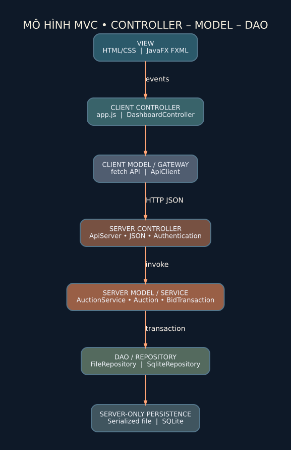
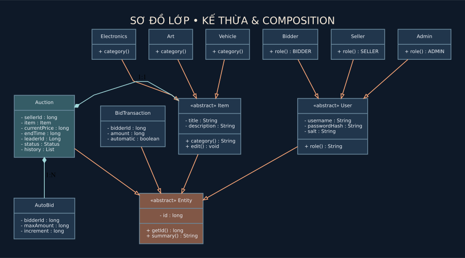
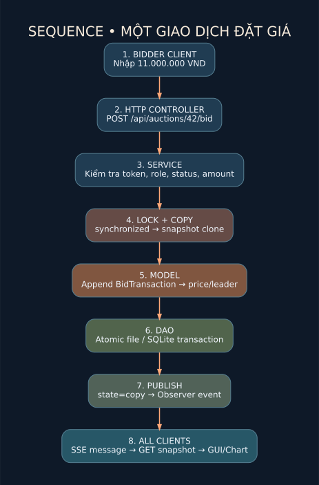
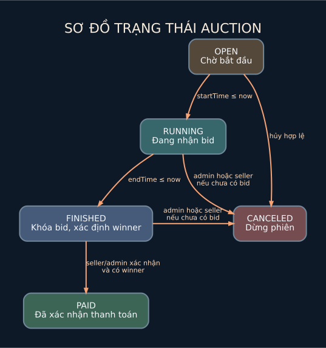

# Kiến trúc và các sơ đồ — đọc để bảo vệ

## 1. Sơ đồ khối vật lý

Mỗi cửa sổ trình duyệt hoặc ứng dụng JavaFX là một **client độc lập**. Chúng đều gửi yêu cầu HTTP/JSON đến **một Java server**. Client không thể thay đổi giá trực tiếp: giá chỉ được thay đổi trong `AuctionService` và lưu trong `Repository`. Observer đẩy sự kiện đến kết nối SSE đã mở lâu dài.

## 2. Tách tầng MVC / DAO

- **View:** HTML/CSS trong browser; JavaFX FXML và `LineChart` trong desktop.
- **Client Controller:** `app.js` handling user events; `DashboardController` xử lý FXML events.
- **Client Model (remote API gateway):** `ApiClient`; Javascript hàm `api()`.
- **Server Controller:** `ApiServer` giải mã JSON, route request, xác thực Bearer token, trả HTTP status.
- **Business Service / Model:** `AuctionService` áp đặt mọi luật đặt giá.
- **DAO:** `Repository` đóng gói I/O; `FileRepository` hoặc `SqliteRepository` thực thi.

Nguyên tắc cốt lõi: **Validation nghiệp vụ luôn nằm ở server**, không chỉ trong HTML hoặc JavaFX.

## 3. Cây kế thừa hướng đối tượng

- `Entity` là abstract base, có `id` và abstract `summary()`.
- `User` kế thừa Entity, abstract `role()`; con gồm `Bidder`, `Seller`, `Admin` (kế thừa và đa hình).
- `Item` kế thừa Entity, abstract `category()`; con gồm `Electronics`, `Art`, `Vehicle`.
- `ItemFactory` tạo đối tượng đúng subtype dựa vào category (**Factory Method đơn giản**; trong code là phương thức `createItem()` được override trong các concrete factory con như GoF Factory Method).
- `Auction` chứa `Item`, danh sách `BidTransaction`, `AutoBid` (composition).
- `AuctionService` (singleton optional) là nơi điều phối nghiệp vụ (service facade), không phải view.

### 4 nguyên lý OOP với ví dụ thực tế

1. **Encapsulation (đóng gói)**: trường username/passwordHash private và được xem qua getter, không cho UI sửa tùy ý.
2. **Inheritance (kế thừa)**: Bidder/Seller/Admin tái sử dụng thuộc tính của User.
3. **Polymorphism (đa hình)**: gọi `role()` qua tham chiếu `User` nhận BIDDER/SELLER/ADMIN.
4. **Abstraction (trừu tượng)**: `User` và `Item` cấm khởi tạo trực tiếp và định nghĩa hành vi chung.

## 4. Sequence diagram cho một lượt đấu giá

1. Bidder nhập giá tại browser/JavaFX và gửi `POST /api/auctions/{id}/bid` kèm Bearer token.
2. `ApiServer` xác thực cấu trúc JSON và chuyển vào `AuctionService.bid()`.
3. Service kiểm tra vai trò, trạng thái `RUNNING`, thời gian server, giá phải lớn hơn hiện tại.
4. Một thread giữ khóa `synchronized` toàn bộ giao dịch; clone snapshot, thực thi, ghi bền vững.
5. **Chỉ sau khi lưu thành công**, thay snapshot công khai rồi gọi Observer/SSE.
6. Mọi client đang kết nối nhận event và tải lại trạng thái chính thức. Biểu đồ được tạo từ lịch sử bid server, không tự đoán số tiền.

## 5. Sơ đồ trạng thái

- `OPEN`: chưa tới giờ bắt đầu, cho xem và sửa sản phẩm nếu chưa có bid.
- `RUNNING`: cho đặt giá hợp lệ.
- `FINISHED`: đến endTime, khóa nhận bid, `leaderId` là người thắng hoặc `null` khi không ai đặt.
- `PAID`: Seller/Admin xác nhận người thắng đã thanh toán (mô phỏng, **không tích hợp cổng thanh toán thực**).
- `CANCELED`: Seller/Admin hủy theo quyền; Seller chỉ được hủy nếu chưa có bid, Admin có thể hủy phiên đang chạy hoặc đã FINISHED nhưng chưa PAID; không còn người thắng.

## 6. Phần JavaFX theo tài liệu tự học

Lớp `AuctionFxApp` tạo `Stage/Scene`; FXML định nghĩa `TableView`, các `TextField`, buttons và `LineChart`; `DashboardController` dùng `@FXML` để đọc dữ liệu, bắt sự kiện và gọi `ApiClient`. Phần xử lý giá nằm trên server chứ không trong controller. Đây là ví dụ cụ thể cho nguyên tắc tách **Model / View / Controller** trong các slide tự học.
