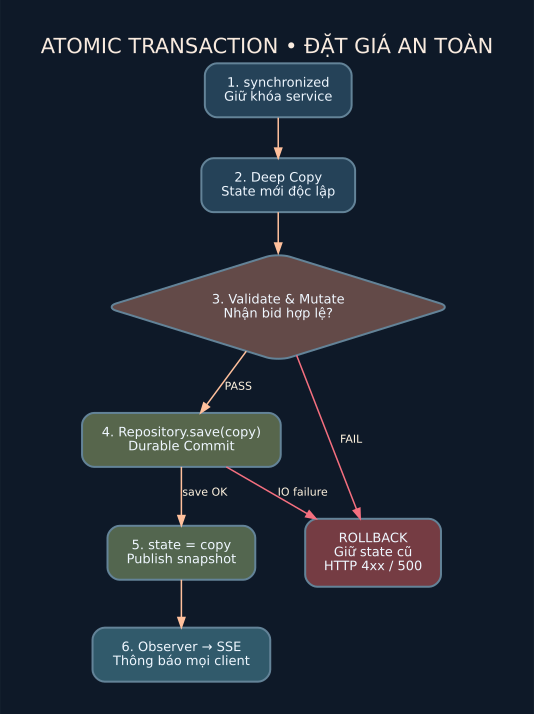

# Các thuật toán quan trọng — giải thích như khi bảo vệ

## 1. Tại sao phải chống Race Condition?

Giả sử giá hiện tại `10.000.000` và hai bidder A/B cùng gửi `11.000.000`:

**Sai nếu không khóa:** A đọc 10m; B đọc 10m; A ghi 11m, B cũng ghi 11m. Cả hai nhận “đặt giá thành công”; có thể có **hai người cùng dẫn đầu**, sai nghiệp vụ.

**Đúng trong code:** `AuctionService.bid()` là `synchronized`; Java chỉ cho một thread chạy trong phương thức ở một thời điểm. A giữ khóa → kiểm tra → ghi bid → lưu → rời khỏi phương thức; B vào sau, thấy giá đã lên 11m, nên giá bằng 11m bị bác bỏ (HTTP 422). Chỉ **một** bid được ghi nhận.

Tại sao sử dụng synchronized khóa toàn service thay vì per-auction `ReentrantLock`? Thiết kế này ưu tiên tính đúng, dễ giải thích và phù hợp mô hình demo một server; nhược điểm là giới hạn thông lượng khi nhiều cuộc đấu giá độc lập. Có thể cải tiến bằng `ConcurrentHashMap<auctionId, ReentrantLock>` và DB transaction per auction, nhưng chưa triển khai trong phiên bản này.

## 2. Giao dịch: sao chép → sửa → lưu → công bố



- **Sao chép State** bằng serialization thành snapshot mới.
- **Kiểm tra mọi điều kiện** trên snapshot sao chép.
- **Sửa snapshot**: tạo `BidTransaction`, đặt `leaderId`, cập nhật giá và `version`.
- **Lưu**: `FileRepository` ghi file tạm rồi atomic rename; `SqliteRepository` có transaction/commit.
- **Công bố**: `state=copy`, sau đó phát event Observer.

Nếu validation hoặc lưu dữ liệu lỗi, `state` cũ không đổi và không có event “giá thành công”. Đó là nguyên tắc **persist before publish**, tránh lỗi “người xem thấy giá mới nhưng server restart mất giá”.

**Giới hạn:** trạng thái chỉ được bảo vệ trước crash phần mềm và lỗi lưu thông thường; độ bền khi mất điện phụ thuộc hệ thống file/SQLite và chưa dùng fsync cho thư mục. Không phải hệ thống ACID phân tán đa server.

## 3. Điều kiện đặt giá

```text
client sends (auctionId, amount, bearerToken)
   |
   v
auth valid? bidder role? auction exists?
   |
   v
RUNNING AND startTime <= serverTime < endTime?
   |
   v
amount > currentPrice? amount within valid VND range?
   |
   v
append BidTransaction -> currentPrice = amount -> leaderId = bidderId
   |
   v
resolve automatic rules -> anti-sniping if applicable
   |
   v
persist -> publish event -> return HTTP 200
```

Khi sai: HTTP 401 (chưa đăng nhập), 403 (không có quyền), 404 (không thấy phiên), 409 (phiên đóng), 422 (giá không hợp lệ) và 400 (input sai định dạng).

## 4. Auto-bidding

Mỗi `AutoBid` có `bidderId`, `maxAmount`, `increment`, `registeredAt` và `registrationOrder`. `AuctionService.setAuto()` ghi cấu hình vào server (mỗi người một quy tắc đang hoạt động cho mỗi phiên). Khi có bid mới, `resolveAuto()`:

1. Bỏ qua quy tắc của người đang dẫn đầu.
2. Chỉ chấp nhận một quy tắc nếu `currentPrice + increment <= maxAmount`.
3. Dùng `PriorityQueue` ưu tiên `maxAmount` cao nhất; nếu bằng nhau, ưu tiên `registeredAt` và `registrationOrder` sớm hơn (nếu timestamp bằng nhau, dùng registrationOrder tăng dần để tie-break xác định).
4. Tạo một **bid thật** trong lịch sử với cờ `automatic=true`.
5. Lặp lại cho đến khi không ai có thể vượt nữa, hoặc chặn vòng lặp không hợp lý (500 lượt).

**Ví dụ:** A bật auto max 8.000, step 1.000, B trả 3.000 → A tự trả 4.000. Nếu B trả 9.000, A không thể vượt max → B dẫn đầu.

**Giới hạn quan trọng cần biết khi bảo vệ:** Thuật toán hiện tạo **PriorityQueue** các quy tắc có thể bid trong mỗi vòng và chọn quy tắc có mức max cao nhất, và chặn tối đa 500 bước để ngăn vòng lặp dài. Do đó chưa tối ưu cho mức max cực lớn và bước giá rất nhỏ. PriorityQueue xử lý thứ tự ưu tiên nhưng chưa giải bài toán nhảy giá thông minh khi có nhiều mức bid nhỏ. Trong bản hiện tại, tính năng là bản minh họa đúng trên mức giá vừa phải, không phải hệ thống proxy bidding sản xuất.

## 5. Anti-sniping

Nếu một bid hợp lệ (kể cả auto-bid) xảy ra trong **30 giây cuối**, kéo `endTime` tới **ít nhất** `serverTime + 60 giây`. Dùng `Math.max(endTime, now + 60_000)` để không bao giờ rút ngắn thời gian phiên. Trong ví dụ nếu 19:59:50 có bid và dự kiến hết lúc 20:00:00 → hết lúc **20:00:50**. Đây là một chính sách thiết kế của nhóm (đề cho phép chọn X và Y).

## 6. Realtime Observer / SSE

`AuctionService.observe()` đăng ký callback; chỉ sau `repository.save` thành công mới gọi các callback. `Events` đưa JSON thông báo vào queue của mọi kết nối SSE. Client nhận qua `EventSource` (web) hoặc thread đọc HTTP stream (JavaFX). Một sự kiện không chứa giá cập nhật đầy đủ mà mang loại sự kiện; client gọi một **GET do sự kiện kích hoạt**, không phải polling liên tục. Đồng hồ đếm ngược 1 giây chỉ cập nhật UI tại client, không gửi request.

**Khả năng phục hồi:** SSE tự reconnect khi mất mạng; client có thể GET trạng thái hiện tại để đồng bộ sau khi reconnect. Mẫu code web hiện tự phục hồi kênh SSE nhờ `EventSource`, nhưng chưa tự GET snapshot khi kênh **vừa reconnect** nếu không có event mới; có thể bổ sung trong phiên bản sau.

## 7. Security boundaries

Mật khẩu PBKDF2-HMAC-SHA256 với salt ngẫu nhiên; admin chỉ bootstrap qua biến môi trường; session bearer token ngẫu nhiên và hết hạn sau 24 giờ; server kiểm tra role từng action. Trình duyệt giữ token trong localStorage; CSP giảm nguy cơ script injection nhưng không loại bỏ mọi dạng XSS. Chạy localhost/LAN có kiểm soát; chưa cấu hình HTTPS, chống brute-force, CSRF cookie vì không dùng cookie, hay rate limiting.
